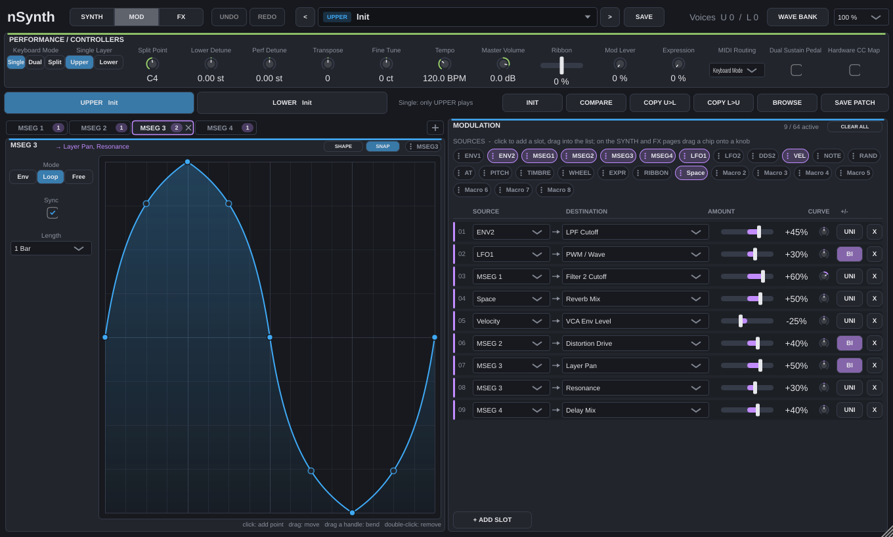
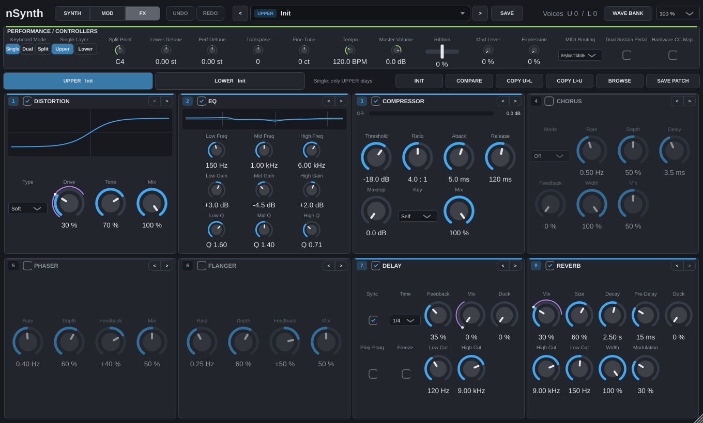

# nSynth Build Guide

This repository contains the JUCE version of **nSynth** — a 128-voice,
bi-timbral hybrid digital/analog-modeled polyphonic synthesizer with
binaural stereo voice pairing, a free modulation matrix (64 slots, 8 macros,
up to 16 drawable MSEGs), a second multimode filter, 32 custom wavetable slots per layer,
adjustable velocity, and a reorderable eight-module effect chain per layer.







The design documents (plan, DSP / UI / preset specs, roadmap, QA) live in `docs/*.md`
locally; they are git-ignored (`docs/.gitignore`), as are the generated reports.

## Current Status

The synthesis core, dual-layer voice architecture, modulation matrix,
wavetable system, MIDI/MPE engine, compact UI, multi-core scheduler, and
factory content are implemented:

- Real-time safe audio thread: no locks, allocations or frees in `processBlock` (checked by
  `RealtimeSafetyTests` with a counting allocator). Modulation snapshots and wave banks are handed
  over through hazard pointers (`RealtimeHandoff`) and freed on the message thread.
- DDS1: 7-core super saw (OFF / 1/2 / ON; measured detune response and centre/side mix
  curves), analog-modelled shapes (slightly convex saw ramp, square with AC-coupled plateau
  droop, rounded triangle, pure sine), noise, morphing, 32 named alternative waveforms
  (`.ws6` I/O): FM = 4-operator FM waves, PD = phase distortion incl. the resonance waves,
  DG = digital waveform spectra, WT = vocal/digital wavetable style. Each layer has its own
  wave bank: a patch carries its custom waves (factory waves are not stored), a performance both.
  Tables are band-limited in half-octave mip levels, crossfaded by pitch: at 44.1/48 kHz every
  note keeps harmonics up to 17-20 kHz, aliases fold back only above 20 kHz, and glides or
  vibrato never step in brightness (see `nSynthAnalysis`).
- DDS2: band-limited oscillator with the same analog shapes, NORM/RING/SYNC, LFO range, sub
  oscillator. Every edge and slope break (including hard sync resets) is corrected with a 24-tap
  Kaiser-windowed-sinc BLEP/BLAMP, so aliasing stays near -90 dB at 48 kHz and -70 dB at 44.1 kHz
  (see `nSynthAnalysis`); DDS1 is delayed by the same 12 samples to stay aligned.
- Cross mod (Exp: exponential FM; Linear: through-zero linear FM, AC-coupled, so it stays in tune
  and DDS1 runs backwards through zero), mixer, 1-pole HPF -> analog-modelled low-pass (VCF TYPE):
  Ladder 24 / Ladder 12 (transistor ladder, tanh in every stage and at the input), Cascade 24
  (OTA cascade), SVF 12 (saturating state-variable filter). All zero-delay-feedback, drive
  OFF/1/2, half the ladder's resonance bass loss made up at the input, self-oscillation;
  the fully open filter stays flat across the audible band. VCA with ENV2/fixed envelopes.
- ENV1 (attack hold, decay hold, loop, inverted, keytrack), ENV2, per-voice LFO1
  (LR phase, HF modes) and LFO2 (trigger modes), drift.
- ANALOG (0 = off, the default): every voice slot keeps its own component tolerances, like the
  parts of a voice card (DDS1/DDS2 tuning +/-4 ct, cutoff +/-0.12 oct, resonance +/-6 %, level
  +/-0.4 dB, envelope times +/-8 %), and the oscillators wander with 1/f pitch noise (~1.5 ct RMS,
  1.5-35 Hz). Patches saved without it load with 0 and sound as before.
- 128-voice pool shared by UPPER/LOWER: Single/Dual/Split, Solo/Legato/Poly 1/Poly 2,
  unison sizes (stacks spread over +/- 1.5 x DETUNE, level-matched to a single voice,
  fanned out over STEREO WIDTH), portamento, hold/sustain. A stolen voice that is still
  sounding keeps its oscillator phases, so voice stealing does not click.
- Binaural Off / x1 / x2: x1 plays one voice per ear (64 stereo notes in Single),
  x2 (default) a mirrored-detuned pair per ear, 4 voices per note (32 notes in Single,
  16 per layer in Dual/Split), with adjustable BINAURAL DETUNE and STEREO WIDTH
  (how far apart the left/right voices sit; 1 = the former hard left/right).
- Velocity: Static (default, every note at STATIC VEL) or Dynamic (played velocity
  through an adjustable curve), plus sensitivity for level and brightness.
- FILTER 2 per voice, Off / Serial (after the VCF) / Parallel (MIX blends both): LP 12/24,
  HP 12/24, band pass, notch (ZDF state-variable), comb +/- (CUTOFF tunes it, RESONANCE is
  the feedback) and formant (CUTOFF morphs A-E-I-O-U); env amount (ENV1/1+2/ENV2), keytrack, drive.
- Modulation: 64 slots, each source -> any continuous layer parameter (per voice, or per
  block for the effects and pan) with amount, curve and uni/bipolar response. Sources: ENV1/2,
  MSEG 1..16, LFO1/2, DDS2, velocity, note, per-note random, poly AT, MPE pitch/timbre, mod wheel,
  expression, ribbon and 8 macros (renamable). Knobs show the modulation range and the live
  value as a ring; route by dragging a source chip onto a knob, the knob's right-click menu, or
  the slot list. Schema 1/2 matrices (fixed grid / direct mapping) load as slots.
- MSEGs: a patch has 1..16 (MOD page tabs: + adds one, x deletes one and the later ones and their
  slots move down; each tab shows how many slots it drives, the open one lists its destinations).
  Drawable multi-segment envelopes / LFOs (up to 32 points, bendable segments, grid
  snap, presets), Env (one-shot) / Loop / Free (layer clock) modes, time 10 ms..30 s or synced
  1/16..8 bars.
- Per-layer air shelf -> eight effect modules in a patch-stored, reorderable order (default:
  distortion -> EQ -> compressor -> chorus -> phaser -> flanger -> delay -> reverb), each
  switched on/off with a 10 ms crossfade: distortion (soft/hard/fold with anti-derivative
  anti-aliasing, tube, crush; tone, mix), 3-band EQ (low shelf, peak, high shelf, each with frequency, gain and Q), compressor (soft knee, parallel mix, keyed
  by the layer itself or the other layer for sidechain ducking), chorus (I/II/I+II), phaser,
  flanger, delay (tempo divisions 1/64..1/1 incl. triplets/dotted or 1..2000 ms, feedback,
  ping-pong, low/high cut, freeze, duck) and reverb (size, decay, pre-delay 0.1..250 ms,
  high/low cut, width, modulation, duck).
- Voices render at the host rate; only the VCF and FILTER 2 (whose saturation would otherwise fold
  back) run at twice the rate, between polyphase IIR half-band resamplers that are flat to 20 kHz
  and 90 dB down from fs - 20 kHz (an open filter at Drive OFF: aliases about -85 dB instead of
  -45 dB). No reported latency; a voice sounds about 12 samples after its note event (DDS2 BLEP
  look-ahead, plus the half-band filters' few samples of group delay); Mix + optional Upper/Lower
  outputs; a stereo-linked safety limiter (-0.3 dBFS ceiling) on the main mix; a non-finite sample can never reach the
  FX feedback loops (the layer would otherwise go silent until reload); lock-free atomic
  work-stealing on real-time worker threads (joining the host audio workgroup where available),
  with one worker budget shared by all instances of the process. Controller events are applied on
  a 16-sample grid, notes sample-accurately. A layer without voices sleeps once its tails are gone.
- Preset loads are atomic: the layer keeps its old state, fades out over 10 ms and restarts
  with the new patch, so a load never plays a mix of both. Master volume, pan and effect
  parameters glide (per sample / 32-sample steps) instead of stepping at block boundaries.
- MIDI: MPE zones (the MPE configuration message sets member channels to a 48 semitone bend
  range; member bend is exact, zone master bend applies to the zone), MIDI learn (sustain,
  (N)RPN and channel-mode CCs are never learned), program change = factory performances
  (also exposed as host programs; program 0 keeps the current sound), mod wheel / expression
  follow whichever of panel or MIDI moved last.
- Editor generated from the parameter registry with uniform scaling 50-200 %: one layer at
  a time (UPPER / LOWER tabs show the loaded patch) on three pages: SYNTH (oscillators ->
  filter -> amp, envelopes/LFOs, voicing, FILTER 2, macros), MOD (MSEG tabs, modulation
  slots) and FX (the effect chain as cards in processing order); performance settings and live
  controllers in one strip.
- Performance presets (`.nsynthperf`), layer patches (`.nsynthpatch`), layer init/copy
  (confirmed when the layer has unsaved changes), undo / redo of everything a performance stores
  (UNDO / REDO, Cmd/Ctrl+Z, Cmd/Ctrl+Shift+Z), and a preset browser (see below).

Factory content: 112 hand-designed, loudness-matched patches in seven categories
and 16 performances (8 layers, 8 splits), plus an offline DSP/CPU analysis target.
Verified on Linux: `nSynthTests` (109,943 checks, 0 failures, including a random-patch
robustness test and the real-time safety tests). AU validation and the AU build have not been
re-run since the modulation/effects rework (now 455 parameters).
Manual host/controller/pluginval
checks remain open (the local `docs/07-QA-AND-VALIDATION.md` tracks them).

The project is configured with CMake and C++17. By default it fetches JUCE
from GitHub during configure time.

## Project Layout

- `JUCE/` contains the CMake project.
- `JUCE/Source/Core/` contains the DSP and engine (shared with the tests).
- `JUCE/Source/Tests/` contains the `nSynthTests` unit/integration tests.
- `Presets/` contains the factory `Patch`/`Performance` library (compiled into the plug-in).
- `.vscode/tasks.json` contains a ready-to-run VS Code build task.

## Requirements

### All Platforms

- CMake 3.22 or newer
- A C++17 compiler
- Git
- Internet access for the first configure step when `NSYNTH_FETCH_JUCE=ON`

## Presets and the preset browser

Click the preset name in the header (or BROWSE in the layer bar) to open the browser:

- PATCHES / PERFORMANCES tabs; patches load into the layer chosen with LOAD INTO
  (UPPER / LOWER, follows the layer selected in the editor). Patches are layer
  independent: any patch loads into either layer.
- Categories with counts, Favourites (click the star) and User; live search by name
  or category.
- A single click (or the arrow keys) auditions a preset immediately; a double click or
  Enter loads it and closes the browser; Esc closes. The `<` / `>` buttons in the header
  step through the current browser list even while it is closed.
- INIT LAYER, SAVE AS..., IMPORT... (copies the file into the user folder),
  OPEN FOLDER and RESCAN.

The factory library is embedded in the binary (`juce_add_binary_data`), so every
format finds it wherever the host or installer puts the bundle. User presets and
favourites live in `~/Documents/nBundleAudio/nSynth/` (`Patches/`, `Performances/`,
sub-folders become user categories, `Favourites.xml`).

The library is generated from the sound designs in
`JUCE/Source/Tools/FactoryContentGenerator.cpp`. The generator renders every patch
with a phrase typical for its category and matches its VCA level, so all factory
sounds play at a similar loudness. From `nSynth/JUCE`:

```bash
cmake --build build --target nSynthFactoryGenerator -j8
./build/nSynthFactoryGenerator_artefacts/Release/nSynthFactoryGenerator --output ../Presets
cmake --build build -j8        # re-embeds the regenerated library
```

Render presets to WAV for listening tests (prints peak and loudness):

```bash
cmake --build build --target nSynthRender -j8
./build/nSynthRender_artefacts/Release/nSynthRender --factory --outdir /tmp/nsynth-renders
./build/nSynthRender_artefacts/Release/nSynthRender --patch ../Presets/Patches/Pads/15_Open_Sky.nsynthpatch --out open-sky.wav
```

## DSP/CPU analysis

From `nSynth/JUCE`:

```bash
cmake --build build --target nSynthAnalysis -j8
./build/nSynthAnalysis_artefacts/Release/nSynthAnalysis --output ../docs/phase6-analysis-report.md
```

Regenerate the factory library with the `nSynthFactoryGenerator` target; see
[Presets and the preset browser](#presets-and-the-preset-browser).

### macOS

- Xcode or Xcode Command Line Tools
- A recent macOS SDK

### Windows

- Visual Studio 2022 with the Desktop development with C++ workload
- MSVC v143 toolset
- Windows 10 or Windows 11 SDK

### Linux

- GCC or Clang with C++17 support
- `make` or Ninja
- Development packages for ALSA, X11, and FreeType

Example packages for Ubuntu or Debian:

```bash
sudo apt update
sudo apt install build-essential cmake ninja-build pkg-config \
  libasound2-dev libjack-jackd2-dev libfreetype6-dev \
  libx11-dev libxext-dev libxinerama-dev libxrandr-dev \
  libxcursor-dev libxcomposite-dev libxrender-dev libglu1-mesa-dev
```

## Build Outputs

- macOS: VST3 and AU
- Windows: VST3
- Linux: VST3

Build artefacts are generated under `JUCE/build/`.

Typical output locations:

- `JUCE/build/nSynth_artefacts/Release/VST3/nSynth.vst3`
- `JUCE/build/nSynth_artefacts/Release/AU/nSynth.component` on macOS
- `JUCE/build/nSynthTests_artefacts/Release/nSynthTests`

`COPY_PLUGIN_AFTER_BUILD` is enabled, so JUCE may also copy the plug-in to
the standard local plug-in folders after a successful build.

## macOS Build

From the repository root:

```bash
cd nSynth
cmake -S JUCE -B JUCE/build -DCMAKE_BUILD_TYPE=Release
cmake --build JUCE/build -j8
```

To clean and rebuild from scratch:

```bash
rm -rf JUCE/build
cmake -S JUCE -B JUCE/build -DCMAKE_BUILD_TYPE=Release
cmake --build JUCE/build -j8
```

## Windows Build

Open a Developer PowerShell for Visual Studio or a normal PowerShell with
Visual Studio in `PATH`, then run:

```powershell
cmake -S JUCE -B JUCE/build -G "Visual Studio 17 2022" -A x64
cmake --build JUCE/build --config Release --parallel
```

To clean and rebuild from scratch:

```powershell
Remove-Item -Recurse -Force JUCE/build
cmake -S JUCE -B JUCE/build -G "Visual Studio 17 2022" -A x64
cmake --build JUCE/build --config Release --parallel
```

If you prefer Ninja on Windows, use a Ninja generator instead of the Visual
Studio generator.

## Tests and validation

```bash
./JUCE/build/nSynthTests_artefacts/Release/nSynthTests          # all tests, exit code 1 on failure
./JUCE/build/nSynthTests_artefacts/Release/nSynthTests --only Engine
./JUCE/build/nSynthTests_artefacts/Release/nSynthTests --dump-params docs/02-PARAMETERS.gen.md
./JUCE/build/nSynthTests_artefacts/Release/nSynthTests --snapshot docs/Plugin.png 1.0 --synth
./JUCE/build/nSynthTests_artefacts/Release/nSynthTests --snapshot docs/PresetBrowser.png 1.0 --browser
./JUCE/build/nSynthTests_artefacts/Release/nSynthTests --snapshot docs/ModPage.png 1.0 --mod
./JUCE/build/nSynthTests_artefacts/Release/nSynthTests --snapshot docs/FxPage.png 1.0 --fx
./JUCE/build/nSynthTests_artefacts/Release/nSynthTests --snapshot docs/WaveBank.png 1.0 --waves
auval -v aumu nSyn NSYA                                          # macOS: AU VALIDATION SUCCEEDED
```

