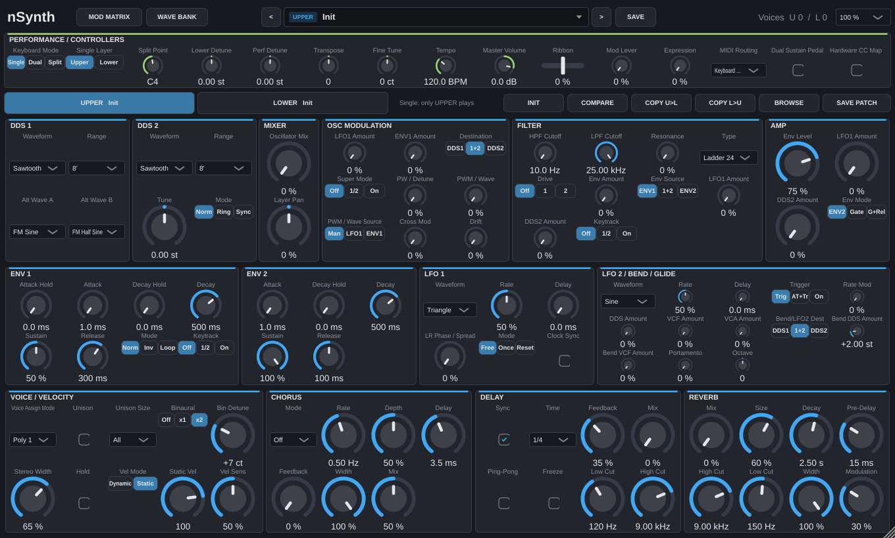
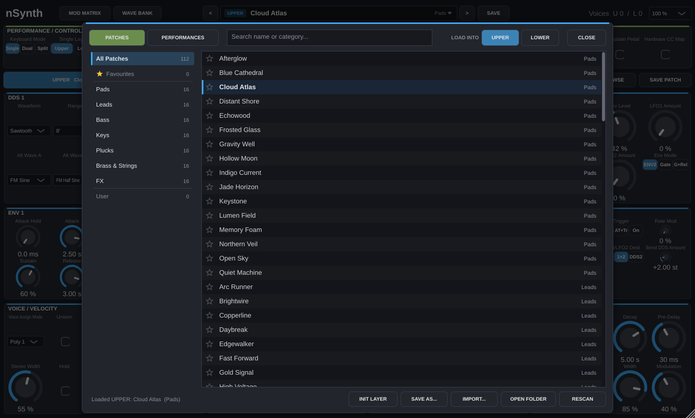
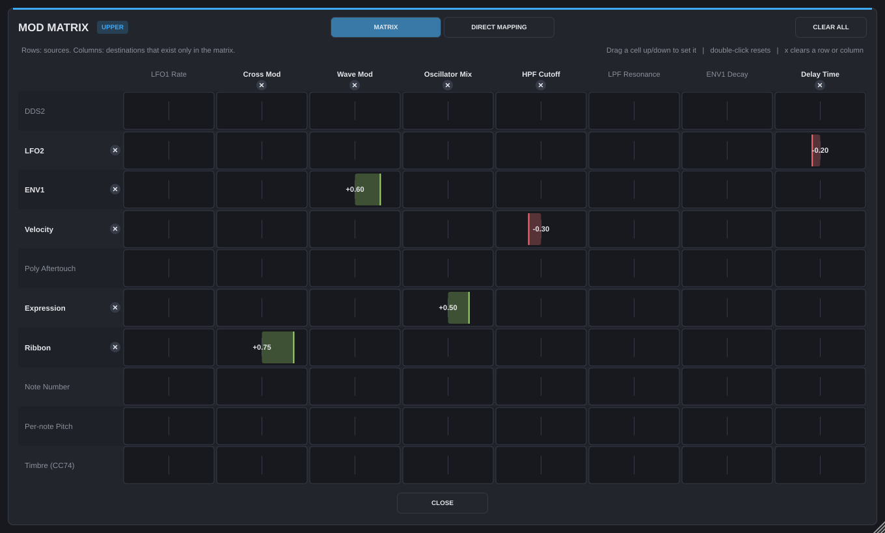
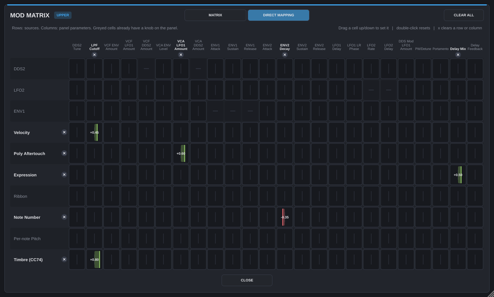
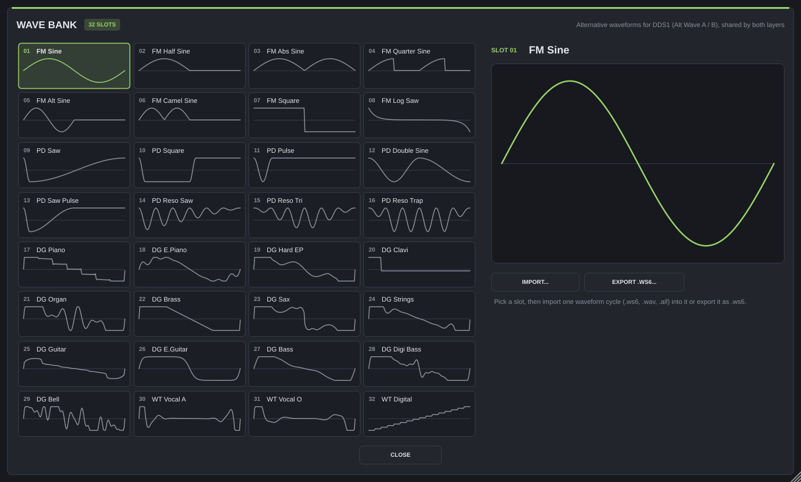

# nSynth Build Guide

This repository contains the JUCE version of **nSynth** — a 128-voice,
bi-timbral hybrid digital/analog-modeled polyphonic synthesizer with
binaural stereo voice pairing, dual-layer modulation, 32 custom wavetable
slots, adjustable velocity, and studio effects (chorus, tempo-synced delay,
reverb).











The full design plan, DSP specification, parameter registry, UI spec,
preset-manager design and phased roadmap live in [docs/](./docs):

- [docs/PLAN.md](./docs/PLAN.md) — start here.
- [docs/08-PLAN-REVIEW.md](./docs/08-PLAN-REVIEW.md)
- [docs/09-TEST-SPEC.md](./docs/09-TEST-SPEC.md)
- [docs/01-ARCHITECTURE.md](./docs/01-ARCHITECTURE.md)
- [docs/02-PARAMETERS.md](./docs/02-PARAMETERS.md)
- [docs/03-DSP-SPEC.md](./docs/03-DSP-SPEC.md)
- [docs/04-UI-SPEC.md](./docs/04-UI-SPEC.md)
- [docs/05-PRESET-MANAGER.md](./docs/05-PRESET-MANAGER.md)
- [docs/06-ROADMAP.md](./docs/06-ROADMAP.md)
- [docs/07-QA-AND-VALIDATION.md](./docs/07-QA-AND-VALIDATION.md)

## Current Status

The synthesis core, dual-layer voice architecture, modulation matrix,
wavetable system, MIDI/MPE engine, compact UI, multi-core scheduler, and
factory content are implemented:

- DDS1: 7-core super saw (OFF / 1/2 / ON; measured detune response and centre/side mix
  curves), analog-modelled shapes (slightly convex saw ramp, square with AC-coupled plateau
  droop, rounded triangle, pure sine), noise, morphing, 32 named alternative waveforms
  (`.ws6` I/O): FM = 4-operator FM waves, PD = phase distortion incl. the resonance waves,
  DG = digital waveform spectra, WT = vocal/digital wavetable style.
- DDS2: polyBLEP oscillator with the same analog shapes, NORM/RING/SYNC, LFO range, sub oscillator.
- Cross mod (exponential FM), mixer, 1-pole HPF -> analog-modelled low-pass (VCF TYPE):
  Ladder 24 / Ladder 12 (transistor ladder, tanh in every stage and at the input), Cascade 24
  (OTA cascade), SVF 12 (saturating state-variable filter). All zero-delay-feedback, drive
  OFF/1/2, half the ladder's resonance bass loss made up at the input, self-oscillation;
  the fully open filter stays flat across the audible band. VCA with ENV2/fixed envelopes.
- ENV1 (attack hold, decay hold, loop, inverted, keytrack), ENV2, per-voice LFO1
  (LR phase, HF modes) and LFO2 (trigger modes), drift.
- 128-voice pool shared by UPPER/LOWER: Single/Dual/Split, Solo/Legato/Poly 1/Poly 2,
  unison sizes (stacks spread over +/- 1.5 x DETUNE, level-matched to a single voice,
  fanned out over STEREO WIDTH), portamento, hold/sustain. A stolen voice that is still
  sounding keeps its oscillator phases, so voice stealing does not click.
- Binaural Off / x1 / x2: x1 plays one voice per ear (64 stereo notes in Single),
  x2 (default) a mirrored-detuned pair per ear, 4 voices per note (32 notes in Single,
  16 per layer in Dual/Split), with adjustable BINAURAL DETUNE and STEREO WIDTH
  (how far apart the left/right voices sit; 1 = the former hard left/right).
- Velocity: Static (default, every note at STATIC VEL) or Dynamic (played velocity
  through an adjustable curve), plus sensitivity for level and brightness.
- Per-layer air shelf -> chorus (I/II/I+II voices, rate, depth, delay, feedback,
  width, mix) -> delay (tempo divisions 1/64..1/1 incl. triplets/dotted or 1..2000 ms,
  feedback, mix, ping-pong, low/high cut, freeze) -> reverb (size, decay, pre-delay,
  high/low cut, width, modulation, mix).
- Fixed 2x internal oversampling; Mix + optional Upper/Lower outputs; a stereo-linked
  safety limiter (-0.3 dBFS ceiling) on the main mix; a non-finite sample can never reach the
  FX feedback loops (the layer would otherwise go silent until reload); lock-free atomic
  work-stealing across all CPU cores.
- Editor generated from the parameter registry with uniform scaling 50-200 %: one layer at
  a time (UPPER / LOWER tabs show the loaded patch), sections in signal-flow order
  (oscillators -> filter -> amp, envelopes/LFOs, voice and effects), performance settings and
  live controllers in one strip.
- Performance presets (`.nsynthperf`), layer patches (`.nsynthpatch`), layer init/copy,
  and a preset browser (see below).

Factory content: 112 hand-designed, loudness-matched patches in seven categories
and 16 performances (8 layers, 8 splits), plus an offline DSP/CPU analysis target.
Verified on Linux: `nSynthTests` (81,065 checks, 0 failures, including a random-patch
robustness test). AU validation and the AU build have not been re-run since the
voice/effects rework (now 215 parameters).
Manual host/controller/pluginval
checks remain open. Current verification status is in
[docs/07-QA-AND-VALIDATION.md](./docs/07-QA-AND-VALIDATION.md), with phase
details in [docs/06-ROADMAP.md](./docs/06-ROADMAP.md).

The project is configured with CMake and C++17. By default it fetches JUCE
from GitHub during configure time.

## Project Layout

- `JUCE/` contains the CMake project.
- `JUCE/Source/Core/` contains the DSP and engine (shared with the tests).
- `JUCE/Source/Tests/` contains the `nSynthTests` unit/integration tests.
- `Presets/` contains the factory `Patch`/`Performance` library (compiled into the plug-in).
- `.vscode/tasks.json` contains a ready-to-run VS Code build task.

## Requirements

### All Platforms

- CMake 3.22 or newer
- A C++17 compiler
- Git
- Internet access for the first configure step when `NSYNTH_FETCH_JUCE=ON`

## Presets and the preset browser

Click the preset name in the header (or BROWSE in the layer bar) to open the browser:

- PATCHES / PERFORMANCES tabs; patches load into the layer chosen with LOAD INTO
  (UPPER / LOWER, follows the layer selected in the editor). Patches are layer
  independent: any patch loads into either layer.
- Categories with counts, Favourites (click the star) and User; live search by name
  or category.
- A single click (or the arrow keys) auditions a preset immediately; a double click or
  Enter loads it and closes the browser; Esc closes. The `<` / `>` buttons in the header
  step through the current browser list even while it is closed.
- INIT LAYER, SAVE AS..., IMPORT... (copies the file into the user folder),
  OPEN FOLDER and RESCAN.

The factory library is embedded in the binary (`juce_add_binary_data`), so every
format finds it wherever the host or installer puts the bundle. User presets and
favourites live in `~/Documents/nBundleAudio/nSynth/` (`Patches/`, `Performances/`,
sub-folders become user categories, `Favourites.xml`).

The library is generated from the sound designs in
`JUCE/Source/Tools/FactoryContentGenerator.cpp`. The generator renders every patch
with a phrase typical for its category and matches its VCA level, so all factory
sounds play at a similar loudness. From `nSynth/JUCE`:

```bash
cmake --build build --target nSynthFactoryGenerator -j8
./build/nSynthFactoryGenerator_artefacts/Release/nSynthFactoryGenerator --output ../Presets
cmake --build build -j8        # re-embeds the regenerated library
```

Render presets to WAV for listening tests (prints peak and loudness):

```bash
cmake --build build --target nSynthRender -j8
./build/nSynthRender_artefacts/Release/nSynthRender --factory --outdir /tmp/nsynth-renders
./build/nSynthRender_artefacts/Release/nSynthRender --patch ../Presets/Patches/Pads/15_Open_Sky.nsynthpatch --out open-sky.wav
```

## DSP/CPU analysis

From `nSynth/JUCE`:

```bash
cmake --build build --target nSynthAnalysis -j8
./build/nSynthAnalysis_artefacts/Release/nSynthAnalysis --output ../docs/phase6-analysis-report.md
```

Regenerate the factory library with the `nSynthFactoryGenerator` target; see
[Presets and the preset browser](#presets-and-the-preset-browser).

### macOS

- Xcode or Xcode Command Line Tools
- A recent macOS SDK

### Windows

- Visual Studio 2022 with the Desktop development with C++ workload
- MSVC v143 toolset
- Windows 10 or Windows 11 SDK

### Linux

- GCC or Clang with C++17 support
- `make` or Ninja
- Development packages for ALSA, X11, and FreeType

Example packages for Ubuntu or Debian:

```bash
sudo apt update
sudo apt install build-essential cmake ninja-build pkg-config \
  libasound2-dev libjack-jackd2-dev libfreetype6-dev \
  libx11-dev libxext-dev libxinerama-dev libxrandr-dev \
  libxcursor-dev libxcomposite-dev libxrender-dev libglu1-mesa-dev
```

## Build Outputs

- macOS: VST3 and AU
- Windows: VST3
- Linux: VST3

Build artefacts are generated under `JUCE/build/`.

Typical output locations:

- `JUCE/build/nSynth_artefacts/Release/VST3/nSynth.vst3`
- `JUCE/build/nSynth_artefacts/Release/AU/nSynth.component` on macOS
- `JUCE/build/nSynthTests_artefacts/Release/nSynthTests`

`COPY_PLUGIN_AFTER_BUILD` is enabled, so JUCE may also copy the plug-in to
the standard local plug-in folders after a successful build.

## macOS Build

From the repository root:

```bash
cd nSynth
cmake -S JUCE -B JUCE/build -DCMAKE_BUILD_TYPE=Release
cmake --build JUCE/build -j8
```

To clean and rebuild from scratch:

```bash
rm -rf JUCE/build
cmake -S JUCE -B JUCE/build -DCMAKE_BUILD_TYPE=Release
cmake --build JUCE/build -j8
```

## Windows Build

Open a Developer PowerShell for Visual Studio or a normal PowerShell with
Visual Studio in `PATH`, then run:

```powershell
cmake -S JUCE -B JUCE/build -G "Visual Studio 17 2022" -A x64
cmake --build JUCE/build --config Release --parallel
```

To clean and rebuild from scratch:

```powershell
Remove-Item -Recurse -Force JUCE/build
cmake -S JUCE -B JUCE/build -G "Visual Studio 17 2022" -A x64
cmake --build JUCE/build --config Release --parallel
```

If you prefer Ninja on Windows, use a Ninja generator instead of the Visual
Studio generator.

## Tests and validation

```bash
./JUCE/build/nSynthTests_artefacts/Release/nSynthTests          # all tests, exit code 1 on failure
./JUCE/build/nSynthTests_artefacts/Release/nSynthTests --only Engine
./JUCE/build/nSynthTests_artefacts/Release/nSynthTests --dump-params docs/02-PARAMETERS.gen.md
./JUCE/build/nSynthTests_artefacts/Release/nSynthTests --snapshot docs/Plugin.png 1.0
./JUCE/build/nSynthTests_artefacts/Release/nSynthTests --snapshot docs/PresetBrowser.png 1.0 --browser
./JUCE/build/nSynthTests_artefacts/Release/nSynthTests --snapshot docs/ModMatrix.png 1.0 --matrix
./JUCE/build/nSynthTests_artefacts/Release/nSynthTests --snapshot docs/ModMatrixDirect.png 1.0 --direct
./JUCE/build/nSynthTests_artefacts/Release/nSynthTests --snapshot docs/WaveBank.png 1.0 --waves
auval -v aumu nSyn NSYA                                          # macOS: AU VALIDATION SUCCEEDED
```

See [docs/07-QA-AND-VALIDATION.md](./docs/07-QA-AND-VALIDATION.md) and
[docs/09-TEST-SPEC.md](./docs/09-TEST-SPEC.md).
